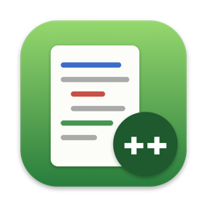
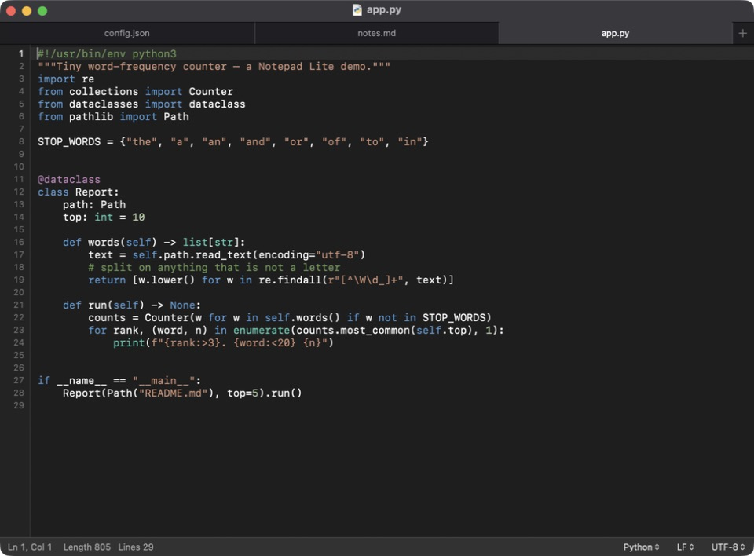

<div align="center">



# Notepad Lite

**The Notepad++ feeling, native on your Mac.**

A fast, tiny (~500 KB), 100% native AppKit text editor for macOS —
tabs, syntax highlighting, regex find & replace, line operations, encodings, and *sudo* saving.
No Electron. No Wine. No subscription.

[](https://github.com/hesampourjam/notepadlite/actions/workflows/build.yml)


[](LICENSE)



</div>

---

## Why?

Notepad++ is one of the most loved editors on Windows — but it has never existed on macOS.
The usual alternatives are either full IDEs, Electron apps that eat a gigabyte of RAM, or
running Notepad++ through Wine.

**Notepad Lite** is a small, honest replacement: it opens instantly, feels like a real Mac app
(native tabs, dark mode, Finder integration), and keeps the Notepad++ features you actually use every day.

## ✨ Features

| | |
|---|---|
| 🗂 **Native tabs** | Open many files in one window (⌘T / ⌘N), drag tabs out into windows, drop files on the editor to open them |
| 🎨 **Syntax highlighting** | 24 languages: Batch, C, C++, C#, CSS/SCSS, Diff, Go, HTML/XML, INI/TOML, Java, JavaScript, JSON, Kotlin, Lua, Markdown, PHP, Python, Ruby, Rust, Shell, SQL, Swift, TypeScript, YAML — auto-detected by extension or shebang |
| 🔍 **Regex Find & Replace** | Notepad++-style panel (⇧⌘F): regular expressions, `$1` groups, `\n` / `\t` in replacements, match case, whole word, wrap around, in-selection, **Count**, **Replace All** — plus the native macOS find bar (⌘F) |
| ✂️ **Line operations** | Duplicate (⌘D), delete (⇧⌘K), move up/down (⌥↑ / ⌥↓), join, sort ascending/descending, remove duplicate lines, remove empty lines, trim trailing whitespace |
| 💬 **Code editing** | Toggle comment (⌘/), indent/outdent (⌘] / ⌘[ or Tab / ⇧Tab on a selection), smart auto-indent, tabs ↔ spaces, UPPER / lower / Title case |
| 🔢 **Editor view** | Line numbers (click to select a line), current-line highlight, word wrap (⌥⌘W), zoom (⌘= / ⌘- / ⌘0), go to `line:column` (⌘L) |
| 🌐 **Encodings** | Auto-detects UTF-8, UTF-8 BOM, UTF-16 LE/BE, Windows-1252, Windows-1256 (Persian/Arabic), Windows-1251, Shift JIS, GB 18030, … — **convert to** or **reopen with** any of them |
| ↩️ **Line endings** | Detects and converts LF / CRLF / CR — one click in the status bar |
| 🔐 **Sudo save** | Edit system files like `/etc/hosts`: saving to a protected location asks for your admin password with the standard macOS prompt and keeps the file's owner and permissions |
| 🌙 **Feels like a Mac** | Dark mode, right-to-left text (Persian, Arabic, Hebrew), Open Recent, Revert, Print, window restoration |

## 📦 Install

Requires **macOS 13 Ventura or later** and the Xcode Command Line Tools (`xcode-select --install`).

```bash
git clone https://github.com/hesampourjam/notepadlite.git
cd notepadlite
./install.sh
```

That builds a release version, puts **Notepad Lite.app** in `/Applications`, and registers it with Finder.
Then open it from Spotlight / Launchpad, or from the terminal:

```bash
open -a "Notepad Lite" ~/.zshrc
```

> Just want the `.app` without installing? Run `./build.sh` — the app lands in `build/Notepad Lite.app`.

**Make it your default text editor:** in Finder, select any `.txt` file → *Get Info* (⌘I) → *Open with: Notepad Lite* → *Change All…*

## ⌨️ Keyboard shortcuts

| Action | Shortcut | | Action | Shortcut |
|---|---|---|---|---|
| New tab | ⌘T | | Duplicate line | ⌘D |
| Open | ⌘O | | Delete line | ⇧⌘K |
| Save / Save As | ⌘S / ⇧⌘S | | Move line up / down | ⌥↑ / ⌥↓ |
| Save All | ⌥⌘S | | Toggle comment | ⌘/ |
| Find | ⌘F | | Indent / Outdent | ⌘] / ⌘[ |
| Find & Replace | ⌥⌘F | | UPPERCASE / lowercase | ⇧⌘U / ⌘U |
| Regex Find & Replace | ⇧⌘F | | Go to line | ⌘L |
| Find next / previous | ⌘G / ⇧⌘G | | Word wrap | ⌥⌘W |
| Reveal in Finder | ⇧⌘R | | Zoom in / out / reset | ⌘= / ⌘- / ⌘0 |

## 🛠 How it's built

Pure Swift + AppKit, **zero dependencies**, ~2,000 lines of code you can read in an afternoon.

```
Sources/NotepadLite/
├── Document.swift              NSDocument: reading, saving, encodings, sudo fallback
├── EditorWindowController.swift  window, tabs, status bar, highlighting schedule
├── EditorTextView.swift        line operations, auto-indent, comments, file drops
├── Language.swift              syntax definitions + highlighter
├── LineNumberRuler.swift       gutter with line numbers
├── FindPanel.swift             regex Find & Replace panel
├── Privileged.swift            admin read/write via the macOS authorization prompt
└── TextEncoding.swift          encoding detection, BOMs, line endings
```

Highlighting uses TextKit 1 temporary attributes, so colors never touch your file or your undo history.
Large files (> 200 K characters) are highlighted around the visible area only, so they stay fast.

### Adding a language

Every language is a few lines in [`Language.swift`](Sources/NotepadLite/Language.swift):

```swift
Language(name: "Lua", ext: ["lua"], line: "--", block: ("--[[", "]]"),
         keywords: "and break do else elseif end false for function if in local nil not or return then true while",
         tokens: [(#"--.*"#, .comment), dq, sq])
```

Pull requests with new languages are very welcome!

## 🗺 Roadmap

- [ ] Find in files (search a whole folder)
- [ ] Bracket matching and code folding
- [ ] Show whitespace / end-of-line characters
- [ ] Column (box) selection editing
- [ ] Session restore for unsaved tabs
- [ ] Themes and a settings window
- [ ] Prebuilt, notarized downloads in Releases

Have an idea? [Open an issue](https://github.com/hesampourjam/notepadlite/issues) — feature requests are how this roadmap gets written.

## 🤝 Contributing

1. Fork the repo and create a branch: `git checkout -b my-feature`
2. Build and run: `./build.sh && open "build/Notepad Lite.app"`
3. Open a pull request with a short description (a screenshot helps for UI changes)

Bug reports with a sample file and steps to reproduce are gold.

## ⭐ Like it?

If Notepad Lite saves you from opening a heavy IDE just to edit a config file, **please give it a star** —
it helps other Mac users who miss Notepad++ find it.

## 🇮🇷 فارسی

**Notepad Lite** یک ویرایشگر متن سبک و کاملاً نیتیو برای مک است، با حس و حال Notepad++:
تب‌ها، رنگ‌آمیزی کد برای ۲۴ زبان، جست‌وجو و جایگزینی با Regex، عملیات روی خطوط،
پشتیبانی از انکودینگ‌های فارسی (مثل Windows-1256) و متن راست‌به‌چپ، و ذخیره‌ی فایل‌های سیستمی با رمز ادمین (مثل `sudo`).

نصب: `git clone` و بعد `./install.sh` — اگر به کارتان آمد، با یک ⭐ حمایت کنید.

## License

[MIT](LICENSE) © 2026 Hesam Pourjam

*Notepad Lite is an independent project inspired by [Notepad++](https://notepad-plus-plus.org/). It is not affiliated with or endorsed by the Notepad++ project.*
